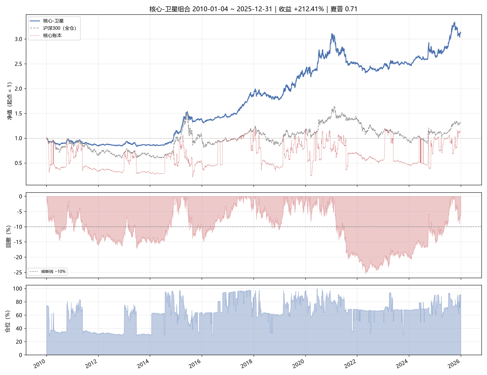
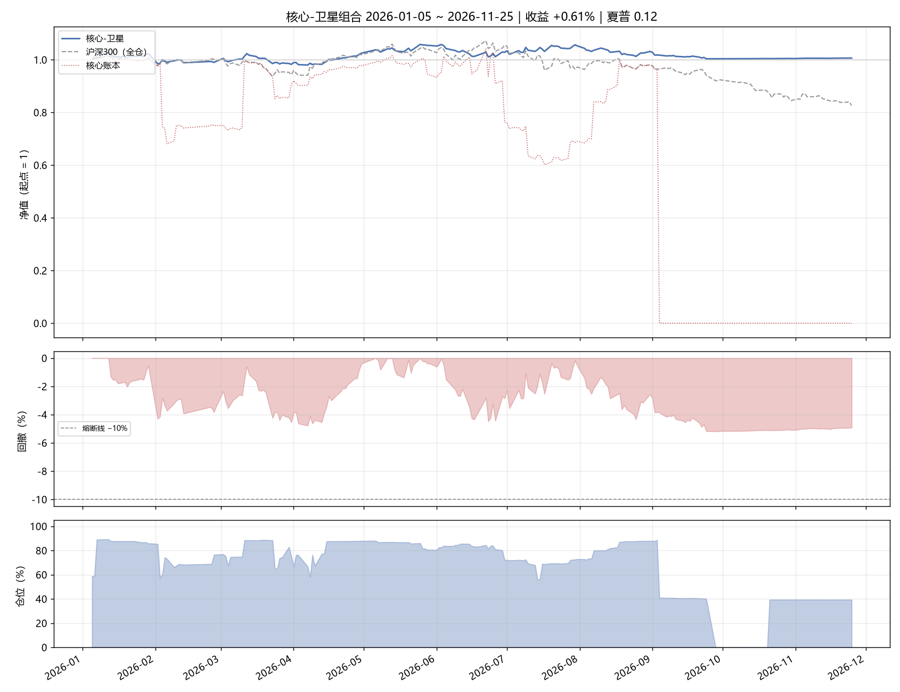
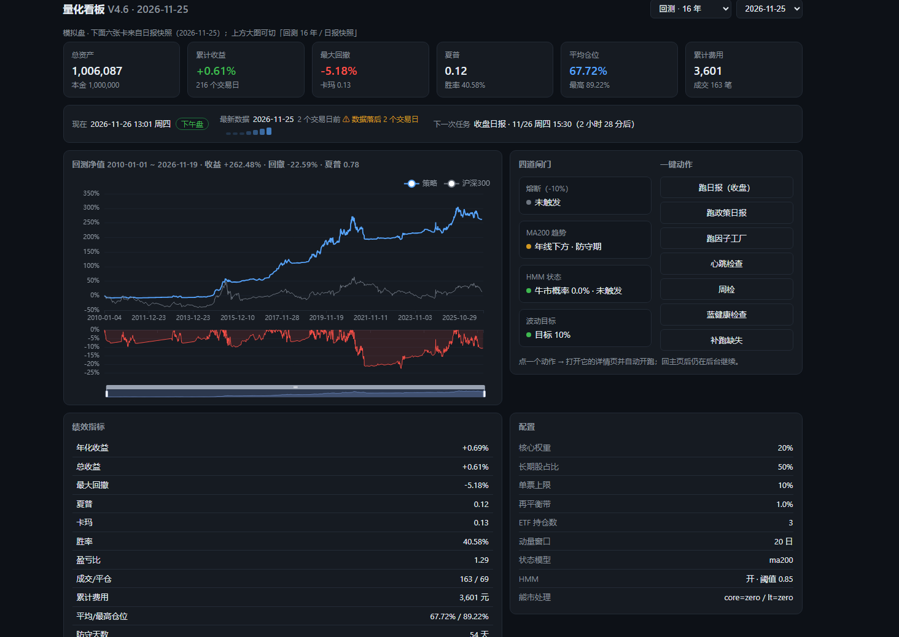

# quant-core

A 股核心-卫星回测框架：HMM 状态闸门、波动目标化、风控、影子盘与日报生成。

**本仓库只含方法，不含因子表达式、alpha 参数与实盘持仓。** 这是刻意的边界：
框架是证据，因子是资产。

```bash
pip install -r requirements.txt
python demo.py            # 合成数据，不联网，30 秒内跑完
```

---

## 两条线（一眼看完）

**① 16 年回测，V4.4 封版口径**：+212.41%，最大回撤 −25.51%，Sharpe 0.71（沪深300 同期 +36.9%）。



**② 2026 年 1–11 月（同一套代码、同参数，滚到今年）**：+0.61%，Sharpe 0.12，最大回撤 −5.18%。



图注（避免误读）：

- 两图都是三段：**净值 / 回撤 / 仓位**；灰虚线是沪深300 满仓基准。
- 细点线「核心账本」画的是**核心持仓的市值**，转防守清仓时会掉到 0 —— 那不是亏光，同一时刻仓位栏也归零。这个「清仓被画成 −100%」的显示口径在 2026-11-24 修过（核心收益改成「期末市值 + 净现金流 − 期初市值」）。
- **②是回测**，不是实盘；真正的影子盘从 2026-11-09 开始逐日记账，目前 12 个交易日、日报无缺口，样本太短，不做绩效结论。

**③ 每天看的看板**（本地 `ThreadingHTTPServer`，手机走 Tailscale 同一页）：



看板上那行「回测 16 年 +262.48%」是**另一条序列**（回测一直滚到 2026-11-19），与 ① 的 V4.4 封版口径（止于 2025-12-31，+212.41%）不可混用；README 的业绩只认 ①。保留这张，是因为它展示的是「四道闸门 + 一键动作 + 数据滞后告警」这些工程件。

---

## 这套东西在做什么

一条 16 年（2010-01 → 2025-12）的日频回测，拆成三层：

| 层 | 文件 | 做什么 |
|---|---|---|
| **核心账本** | `core_satellite.py` | 20% 底仓长期持有沪深300，转防守时清零（V4.6） |
| **卫星账本** | `cs_strategy.py` `cs_regime.py` `cs_hmm.py` | 行业 ETF 动量轮动 + MA200 状态闸门 + HMM 牛市概率，防守期换国债/黄金 |
| **风控与口径** | `cs_risk.py` `portfolio.py` | 手续费/印花税/滑点、分批建仓、回撤熔断、指标与对账 |

数据层 `cs_data.py` 负责取数（akshare）、缓存、复权、交易日历对齐；`daily_report.py`
把每天的结果写成日报；`paper.py` 是「目标持仓 → 模拟成交 → 净值」的影子盘。

## 复现方式

```bash
python demo.py                                    # 合成数据，验证流水线
python core_satellite.py --start 2010-01-01 --end 2025-12-31   # 真实回测（需 akshare 网络）
python core_satellite.py --version                # 打印引擎版本与关键参数
python core_satellite.py --selftest               # 口径自检（不依赖行情）
```

引擎有两个版本并存：`core_satellite.py`（V4.6，默认 `core_bear=zero`）与
`core_satellite_v45.py`（V4.5，`half`）。**这不是笔误，是刻意留的对照版本**——
V4.6 的降回撤实验就是拿 V4.5 做基线，见 `docs/V4.4_封版说明_2026-11-10.md`。
跑之前先 `--version` 确认用的是哪一个。

## 目录

```
core_satellite.py / core_satellite_v45.py   主回测（V4.6 / V4.5）
cs_data.py        数据层：取数、缓存、复权、日历对齐
cs_regime.py      状态闸门（MA200 + 缓冲带 + 连续确认）
cs_hmm.py         隐状态模型：牛市概率
cs_risk.py        费用、滑点、手数、熔断
cs_strategy.py    默认参数（核心占比、行业上限、持仓数、band…）
cs_ensemble.py    多组参数集成
cs_value.py       估值闸门
portfolio.py      个股组合引擎（持仓、成交记录、指标、报告）
signal_assistant.py  单票价格获取与清洗（组合引擎的数据前置）
paper.py          影子盘：每日目标持仓 → 模拟成交 → 净值
daily_report.py   日报生成（15:30 / 20:00 / 周一）
audit_cs.py       回测结果审计
env_snapshot.py   环境快照（排查「为什么你那儿能跑我这儿不能」）
quant_v5/         截面选股研究框架（复现、微盘、退市）
docs/             设计文档（架构、状态闸门、封版说明、过拟合体检）
demo.py           合成数据跑通整条流水线
```

## 已知边界

1. **`demo.py` 的数字不是策略绩效。** 它用固定 seed 的几何随机漫步喂给引擎，
   只证明「框架能跑、状态机在切换、口径是连着的」。
2. **`daily_report.py` 的新闻模块是可选的。** 新闻抓取涉及外部站点与凭据，没有随仓库发布；
   该模块缺失时日报会自动跳过新闻段（`news_harvest = None`），其余照常。
3. **AKShare 取数依赖网络与站点可用性**，接口变动会导致取数失败；`cs_data.py`
   里有重试、增量补齐与「滞后即抛错」的保护，但数据源本身不在本项目控制内。
4. **不构成投资建议。** 回测与影子盘都是研究工具，实盘未接入下单。

## 口径约定（踩过坑，写下来免得再踩）

- **换手**：平台/台账口径一律 1%–70%，低于 1% 直接不合格；12.5% 是 Fitness 的分母地板，
  不是「允许的下限」。
- **Fitness** = Sharpe × sqrt(|年化收益| / max(换手, 12.5%))。
- **收益拆解必须对账**：利息 + 交易已实现 + 持仓浮动 == 总盈亏，误差 > 1 元就报错。
- **清仓 ≠ 亏损**：核心腿序列末值为 0 是「卖了」，不是「亏光」；收益按
  「期末市值 + 净现金流 − 期初市值」计。这个 bug 曾经让报告显示 -100%。
- **行情滞后**：数据截止 < 最近交易日就抛错退出，绝不用旧数据算出一份「看起来成功」的日报。

## License

MIT（见 `LICENSE`）。代码可读可学可改；**因子表达式、alpha 参数与研究结论不在本仓库范围内**，也不在授权范围内。
